<a href="https://ujjwalrupakheti.com.np">
  
</a>

<p align="center">
  <a href="https://ujjwalrupakheti.com.np"></a>
  <a href="https://www.linkedin.com/in/ujjwal-rupakheti-bb421b339/"></a>
  <a href="https://www.instagram.com/ujjwalrupakheti.dev/"></a>
  
</p>

<p align="center">
  
</p>

<p align="center">
  
</p>

<p align="center">
  I design, build and ship full products, from the database to the last pixel, and then make sure people can find them on Google and AI search.<br/>
  Most of what I build is made for Nepal: Bikram Sambat dates, Nepali first, eSewa and Khalti built in.
</p>

<p align="center">
  
</p>

<p align="center">
  <a href="https://nimtto.com"></a>
  <a href="https://eknas.com"></a>
  <a href="https://jhino.com"></a>
  <a href="https://heligo.studionepal.com"></a>
  <a href="https://eutaa.com"></a>
  <a href="https://pustau.com"></a>
  <a href="https://www.linkedin.com/in/ujjwal-rupakheti-bb421b339/details/projects/"></a>
  <a href="https://www.linkedin.com/in/ujjwal-rupakheti-bb421b339/details/projects/"></a>
</p>

<p align="center"><sub>Click any card to open the live product.</sub></p>

<details>
<summary><b>&nbsp;Open the build notes for each product</b></summary>
<br/>

| Product | What it does | What I built | Stack |
|:--|:--|:--|:--|
| **[Nimtto](https://nimtto.com)** | Online wedding invitations for Nepal | 39 interactive themes incl. a 3D walk through Bhaktapur Durbar Square, a studio dashboard, BS + AD dates, per-ceremony RSVP | Vite, Three.js, GSAP, Node, Express, SQLite |
| **[Eknas](https://eknas.com)** | Loyalty and rewards for local shops | Customer wallet, counter app, business dashboard, super admin, rotating signed QR codes, public API with OpenAPI 3.1 and webhooks | Next.js 15, React 19, TypeScript, PostgreSQL, Prisma |
| **[Jhino](https://jhino.com)** | Turn an HTML file into a live web app | Sandboxed uploads, real-time sync with conflict merging, roles, custom domains via Cloudflare for SaaS | TypeScript, Node, React, SQLite, Docker, Playwright |
| **[HeliGo Nepal](https://heligo.studionepal.com)** | Helicopter charter marketplace | Quote builder, dispatch, manifests, settlements, an AI trip-planning assistant | React, Express, Prisma, PostgreSQL, FastAPI |
| **[Eutaa](https://eutaa.com)** | Company operating system | HR, payroll, finance with Nepal compliance, projects, and an MCP server for AI assistants | Fastify 5, Drizzle, PostgreSQL, React 19 |
| **[Pustau](https://pustau.com)** | Digital family heritage record | Family tree, tithi and patro, BS to AD verified for 1970 to 2100, shraddha dates | Next.js 16, TypeScript, PostgreSQL, Docker |
| **Pristha** | Report cards for Nepali schools | Multi-tenant SaaS for principals, teachers and parents, 819 API tests on a real database | Fastify 5, Prisma 7, PostgreSQL 16, React |
| **Domain Finder Agent** | Finds available short .com names | DNS + RDAP checking pipeline, pronounceability model, Devanagari romanisation | Python, Flask, SQLite, ML |

</details>

<p align="center">
  
</p>

<p align="center">
  <br/>
  
</p>

<p align="center">
  
</p>

<p align="center">
  
</p>

<details>
<summary><b>&nbsp;Open my dev console</b></summary>
<br/>

```ts
const ujjwal = {
  basedIn: "Kathmandu, Nepal",
  role: "Full-stack web & software developer",
  alsoDoes: ["SEO", "AEO", "GEO"],          // getting found on Google *and* in AI answers
  shipped: ["Nimtto", "Eknas", "Jhino", "HeliGo", "Eutaa", "Pustau", "Pristha"],
  favouriteStack: ["TypeScript", "Next.js", "Node", "PostgreSQL", "Prisma"],
  rules: [
    "money is stored in paisa, never floats",
    "dates speak Bikram Sambat",
    "every page is built to rank",
  ],
  openTo: "freelance builds, product collaborations and good ideas",
};
```

</details>

<details>
<summary><b>&nbsp;Need a website or app? Here's how I work</b></summary>
<br/>

1. **Talk** — we pin down who it's for and what it must do.
2. **Design** — clickable screens before a single line of production code.
3. **Build** — weekly live links, so you see real progress.
4. **Launch** — fast, secure, and set up to rank on Google and AI search from day one.

Message me on [LinkedIn](https://www.linkedin.com/in/ujjwal-rupakheti-bb421b339/) or [Instagram](https://www.instagram.com/ujjwalrupakheti.dev/).

</details>


