<a href="https://ujjwalrupakheti.com.np">
  
</a>

  
  
  
  

  


  

  <a href="https://nimtto.com"></a>
  <a href="https://eknas.com"></a>
  <a href="https://jhino.com"></a>
  <a href="https://heligo.studionepal.com"></a>
  
  <a href="https://pustau.com"></a>
  
  

<b>&nbsp;Read the engineering notes for each product</b>

 

| Product | What I built | Stack |
|:--|:--|:--|
| **[Nimtto](https://nimtto.com)** | 39 interactive themes, including a 3D walk through Bhaktapur Durbar Square and a WebGL lotus lake. A studio dashboard, Bikram Sambat and AD dates, and per-ceremony RSVP with CSV export. | Vite, Three.js, GSAP, Node, Express, SQLite |
| **[Eknas](https://eknas.com)** | Customer wallet, counter app, business dashboard and super admin. Rotating signed QR codes, idempotent bill recording, and a public API with OpenAPI 3.1 and signed webhooks. | Next.js 15, React 19, TypeScript, PostgreSQL, Prisma |
| **[Jhino](https://jhino.com)** | Sandboxed HTML uploads, real-time sync with conflict merging, roles and invite links, and custom domains through Cloudflare for SaaS. | TypeScript, Node, React, SQLite, Docker, Playwright |
| **[HeliGo Nepal](https://heligo.studionepal.com)** | Quote builder, dispatch, flight manifests, settlements and a ledger in paisa, plus an AI trip-planning assistant as a separate service. | React, Express, Prisma, PostgreSQL, FastAPI |
| **Eutaa** | HR, payroll, finance with Nepal compliance (VAT, SSF, TDS) and projects. Server-side permissions, an audit log, and an MCP server for AI assistants. | Fastify 5, Drizzle, PostgreSQL, React 19 |
| **[Pustau](https://pustau.com)** | Family tree, tithi and patro. BS to AD conversion verified from 1970 to 2100, and shraddha dates calculated the way a priest would. | Next.js 16, TypeScript, PostgreSQL, Docker |
| **Pristha** | Multi-tenant SaaS for principals, teachers and parents, with an academic ledger and 819 API tests against a real database. | Fastify 5, Prisma 7, PostgreSQL 16, React |
| **Domain Finder Agent** | DNS and RDAP checking pipeline, a pronounceability model and Devanagari romanisation (सपना → sapna). | Python, Flask, SQLite, ML |
| **Pentagon Carpets** | Website and self-service CMS for a handmade carpet exporter, with CI/CD on GitHub Actions. | React, Express, PostgreSQL, Node |

  


  


  

Open the one that matches what you need.

<b>&nbsp;A website for my business</b>

 

A fast, mobile-first site that explains what you do and turns visitors into enquiries.

- Clean design built around your brand, with pages you can edit yourself
- Technical SEO from day one: structured data, sitemap, fast loading
- Set up to be understood by AI search (AEO and GEO), not only Google
- Enquiry forms, WhatsApp links and maps where they help

Example: **[Pentagon Carpets](https://www.linkedin.com/in/ujjwal-rupakheti-bb421b339/details/projects/)**, a catalogue site with a self-service CMS for a carpet exporter.

<b>&nbsp;A web app or SaaS product</b>

 

From the first screen to paying customers.

- Accounts, roles and permissions checked on the server
- Dashboards, admin consoles and reports
- Payments with eSewa, Khalti, bank QR or PayPal
- Tests, audit logs and deployments you can trust

Examples: **[Eknas](https://eknas.com)**, **[Jhino](https://jhino.com)** and **[HeliGo Nepal](https://heligo.studionepal.com)**.

<b>&nbsp;To be found on Google and in AI answers</b>

 

For an existing site that is hard to find.

- A technical audit: speed, indexing, structured data and site structure
- Content that answers what people actually search for
- AEO and GEO, so ChatGPT, Gemini and Google AI Overviews can cite you

Every product above ships with these built in.

<b>&nbsp;A developer to take my product further</b>

 

For a product that already exists and needs to grow.

- Review the codebase and fix what slows the team down
- Add features without breaking what already works
- Redevelop older systems on a cleaner architecture

Example: I redeveloped an earlier platform, KLIXIR, into **Eutaa**, with a stronger security model and a much broader product.

  

   
  

  

  Have a product in mind? Tell me what you are building and who it is for.

  
  
  

