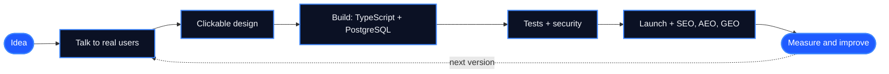

<a href="https://ujjwalrupakheti.com.np">
  
</a>

<p align="center">
  <a href="#products"></a>
  <a href="#impact"></a>
  <a href="#quiz"></a>
  <a href="#stack"></a>
  <a href="#say-hi"></a>
</p>

<p align="center">
  
</p>

<p align="center">
  
</p>

<p align="center">
  I design, build and ship full products, from the database to the last pixel,<br/>
  then make sure people can find them on Google and in AI answers.<br/>
  Most of it is made for Nepal: Bikram Sambat dates, Nepali first, eSewa and Khalti built in.
</p>

<a id="impact"></a>
<p align="center">
  
</p>

<p align="center">
  
</p>

<a id="products"></a>
<p align="center">
  
</p>

<p align="center">
  <a href="https://nimtto.com"></a>
  <a href="https://eknas.com"></a>
  <a href="https://jhino.com"></a>
  <a href="https://heligo.studionepal.com"></a>
  <a href="https://eutaa.com"></a>
  <a href="https://pustau.com"></a>
  <a href="https://www.linkedin.com/in/ujjwal-rupakheti-bb421b339/details/projects/"></a>
  <a href="https://www.linkedin.com/in/ujjwal-rupakheti-bb421b339/details/projects/"></a>
</p>

<p align="center"><sub>Every card is clickable. Go on, open one.</sub></p>

<details>
<summary><b>&nbsp;Peek under the hood of each product</b></summary>
<br/>

| Product | What I built | Stack |
|:--|:--|:--|
| **[Nimtto](https://nimtto.com)** | 39 interactive themes, including a 3D walk through Bhaktapur Durbar Square and a WebGL lotus lake. A studio dashboard, BS + AD dates and per-ceremony RSVP. | Vite, Three.js, GSAP, Node, Express, SQLite |
| **[Eknas](https://eknas.com)** | Customer wallet, counter app, business dashboard and super admin. Rotating signed QR codes, a public API with OpenAPI 3.1 and signed webhooks. | Next.js 15, React 19, TypeScript, PostgreSQL, Prisma |
| **[Jhino](https://jhino.com)** | Sandboxed HTML uploads, real-time sync with conflict merging, roles, and custom domains via Cloudflare for SaaS. | TypeScript, Node, React, SQLite, Docker, Playwright |
| **[HeliGo Nepal](https://heligo.studionepal.com)** | Quote builder, dispatch, flight manifests, settlements and an AI trip-planning assistant. | React, Express, Prisma, PostgreSQL, FastAPI |
| **[Eutaa](https://eutaa.com)** | HR, payroll, finance with Nepal compliance (VAT, SSF, TDS), projects, and an MCP server for AI assistants. | Fastify 5, Drizzle, PostgreSQL, React 19 |
| **[Pustau](https://pustau.com)** | Family tree, tithi and patro, BS to AD verified from 1970 to 2100, shraddha dates calculated the way a priest would. | Next.js 16, TypeScript, PostgreSQL, Docker |
| **Pristha** | Multi-tenant SaaS for principals, teachers and parents, with 819 API tests against a real database. | Fastify 5, Prisma 7, PostgreSQL 16, React |
| **Domain Finder Agent** | DNS + RDAP checking pipeline, a pronounceability model and Devanagari romanisation (सपना → sapna). | Python, Flask, SQLite, ML |
| **Pentagon Carpets** | Website and self-service CMS for a handmade carpet exporter, with CI/CD on GitHub Actions. | React, Express, PostgreSQL, Node |

</details>

<a id="quiz"></a>
<p align="center">
  
</p>

<p align="center"><sub>Four questions. Click a question to check your answer. No cheating by scrolling up.</sub></p>

<details>
<summary><b>&nbsp;1. Which product lets you walk through Bhaktapur Durbar Square in 3D before reading a wedding invitation?</b></summary>
<br/>

**[Nimtto](https://nimtto.com).** Guests tap, the square comes alive in WebGL, and the invitation opens like a real card.
</details>

<details>
<summary><b>&nbsp;2. Which one turns every 1 rupee you spend at a café into 1 point?</b></summary>
<br/>

**[Eknas](https://eknas.com).** Rewards unlock with a 6-character code that works once and expires in 15 minutes, so nobody can cheat it.
</details>

<details>
<summary><b>&nbsp;3. Which one can tell you the shraddha date for an ancestor, the way a priest would?</b></summary>
<br/>

**[Pustau](https://pustau.com).** It keeps a family's vamshavali in Bikram Sambat and around the tithi.
</details>

<details>
<summary><b>&nbsp;4. Which one lets AI assistants like Claude work with a company's HR and payroll?</b></summary>
<br/>

**[Eutaa](https://eutaa.com).** It ships with an MCP server and scoped, revocable tokens.

Four out of four? You should probably [say hi](#say-hi).
</details>

<p align="center">
  
</p>



<a id="stack"></a>
<p align="center">
  
</p>

<p align="center">
  <br/>
  
</p>

<p align="center">
  
</p>

<p align="center">
  
</p>

<details>
<summary><b>&nbsp;Open my dev console</b></summary>
<br/>

```ts
const ujjwal = {
  basedIn: "Itahari, Nepal",
  role: "Full-stack web & software developer",
  alsoDoes: ["SEO", "AEO", "GEO"],          // getting found on Google *and* in AI answers
  shipped: ["Nimtto", "Eknas", "Jhino", "HeliGo", "Eutaa", "Pustau", "Pristha"],
  favouriteStack: ["TypeScript", "Next.js", "Node", "PostgreSQL", "Prisma"],
  rules: [
    "money is stored in paisa, never floats",
    "dates speak Bikram Sambat",
    "every page is built to rank",
  ],
  openTo: "freelance builds, product collaborations and good ideas",
};
```

</details>

<a id="say-hi"></a>
<details open>
<summary><b>&nbsp;Need a website or app? Here's how I work</b></summary>
<br/>

1. **Talk:** we pin down who it's for and what it must do.
2. **Design:** clickable screens before a single line of production code.
3. **Build:** weekly live links, so you see real progress.
4. **Launch:** fast, secure, and set up to rank on Google and in AI answers from day one.

<p align="center">
  <a href="https://www.linkedin.com/in/ujjwal-rupakheti-bb421b339/"></a>
  <a href="https://www.instagram.com/ujjwalrupakheti.dev/"></a>
  <a href="https://ujjwalrupakheti.com.np"></a>
</p>

</details>

<p align="center">
  
</p>


